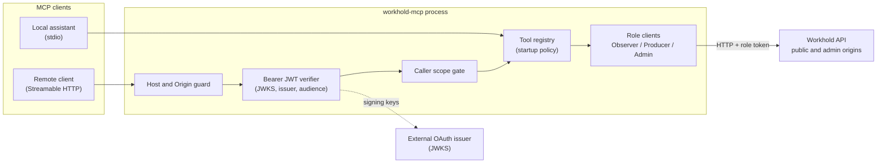
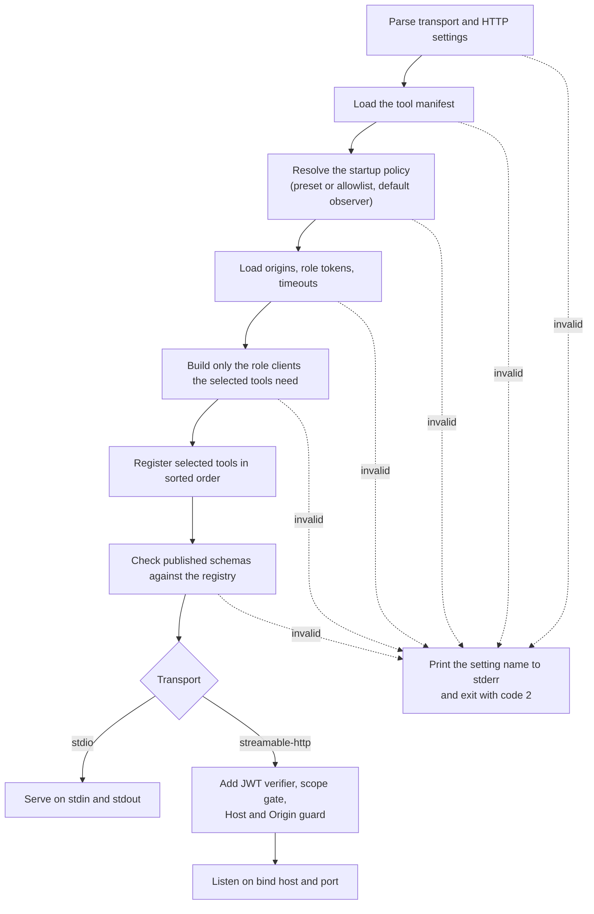
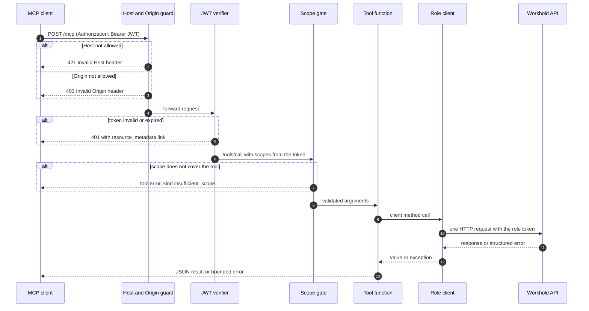
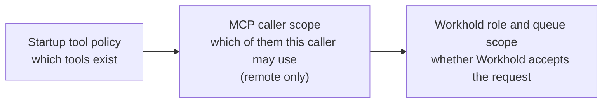

# How the MCP adapter works

[Documentation](../README.md) › [Architecture](README.md) › **MCP adapter**

`workhold-mcp` lets an AI assistant or any other
[Model Context Protocol](https://modelcontextprotocol.io/) client inspect and
operate Workhold through a fixed set of tools. This page explains how the
adapter is built and what happens during one tool call. Installation, flags, and
environment variables are in the
[setup guide](../02-guides/07-local-mcp-observer.md). The decisions behind the
design are in [ADR 033](adr/033-optional-local-mcp-adapter.md),
[ADR 034](adr/034-mcp-tool-exposure-ceiling.md), and
[ADR 035](adr/035-remote-mcp-resource-server.md).

## In one paragraph

The adapter is a thin translator. It is a separate process with its own release
train, and the runtime image does not contain it. At startup it picks a tool
set, builds only the Python role clients that set needs, and registers one MCP
tool per client method. Each tool call becomes one HTTP request to the Workhold
API, made with a role token from the process environment. The adapter keeps no
state, opens no database connection, and adds no authority: Workhold authorizes
every request exactly as it would for any other client.

## Components



Both transports share one tool registry and the same role clients. The remote
path only adds the HTTP checks in front of it.

| Part | Module | Responsibility |
| --- | --- | --- |
| Entry point | `cli.py` | Validate everything, then serve on stdio or HTTP; exit code 2 on bad configuration |
| Settings | `config.py` | Read origins, role tokens, timeouts, and HTTP settings; never echo a value |
| Startup policy | `policy.py` | Turn `--preset`, `--allow-tool`, or their environment variables into a fixed set of tool names |
| Tool catalog | `registry.py`, `data/tool-manifest.json` | Map every tool name to a role, a client method, an input schema, and preset membership |
| Server | `server.py` | Build role clients, register tools, check schemas, dispatch calls, install the scope gate |
| Remote app | `http_app.py` | Serve `/mcp` as stateless JSON Streamable HTTP and publish protected resource metadata |
| Host and Origin guard | `transport_guard.py` | Reject DNS-rebinding requests before any token is read |
| Token verifier | `jwt_verifier.py` | Verify RS256 or ES256 JWTs against one JWKS, issuer, and audience |
| Scopes | `scopes.py` | Map a tool's role to the one OAuth scope that guards it |
| Results | `serialize.py`, `errors.py` | Turn client values into JSON and exceptions into six bounded fields |

All modules live in `packages/workhold-mcp/src/workhold_mcp/`.

## Startup

Startup is fail-closed. Every check runs before stdio opens or the port binds,
so a misconfigured process never serves a single request.



A few properties follow from this order:

- **The tool set is frozen.** Tools are chosen once and do not change for the
  process lifetime. Discovery always returns them sorted by name.
- **Only needed credentials are read.** An observer-only process never builds a
  producer or admin client, so it never needs those tokens. One role token is
  never borrowed for another role.
- **Schema drift fails startup.** The MCP SDK derives each tool's input schema
  from a generated function signature. The server compares that schema with
  the registry and refuses to start if a field, type, page limit, or required
  set differs.
- **Errors do not leak values.** A rejection names the setting or flag, never
  the value that was supplied.

## Tool catalog

The catalog is a checked-in manifest. Each row names a role, the client class,
the client method, the OpenAPI operation id, and the presets that include it.
The loader rejects a duplicate name, a name that is not `<role>_<method>`, or
preset membership that does not match the role.

| Role | Client | Tool prefix | Tools | Presets | OAuth scope |
| --- | --- | --- | --- | --- | --- |
| Observer | `ObserverClient` | `observer_` | 9 read-only | `observer`, `routine` | `workhold-mcp:read` |
| Producer | `ProducerClient` | `producer_` | 5 | `producer`, `routine` | `workhold-mcp:produce` |
| Admin | `AdminClient` | `admin_` | 19 routine admin | `operator`, `routine` | `workhold-mcp:operate` |

Each tool carries MCP annotations: `readOnlyHint` is set for reads, and
`openWorldHint` is set for every tool because each call reaches an external
service.

The catalog is an exposure ceiling: startup policy can only narrow it. It
deliberately has no claim, heartbeat, complete, fail, or break-glass tool, so
worker leases stay with the consumer SDK and recovery stays with the
break-glass plane ([ADR 034](adr/034-mcp-tool-exposure-ceiling.md)). Tools are
dispatched through explicit handlers, never by looking up a client attribute a
model names. Bulk replay and bulk cancel need the preview object returned by the matching
preview tool; the adapter never caches a preview or previews on its own.

## One tool call

The diagram follows a remote `tools/call`. On stdio the first three steps do
not exist: the local process that started the adapter is the only caller.



### HTTP checks

- **Host and Origin first.** The guard is the outermost ASGI layer. It answers
  421 for a Host outside the allowlist and 403 for an Origin outside the
  allowlist, without calling the inner app. A DNS-rebinding request therefore
  never reaches token verification. In no-browser mode every request that
  carries an `Origin` header is rejected. The same settings are also passed to
  the SDK app as a second check.
- **Token second.** The verifier reads only the `alg` header before loading a
  key. It accepts RS256 and ES256, takes keys from the one configured JWKS URL,
  and requires `exp`, `iss`, and an `aud` equal to the resource URL. Header
  fields such as `jku` or `x5u` never choose a URL to fetch. Any failure,
  including a key-loader error, becomes an anonymous 401 whose
  `WWW-Authenticate` header points to the protected resource metadata.
- **Scope third.** Scopes come from the `scope` or `scp` claim; if both are
  present they must carry the same set. `tools/list` hides tools the token's
  scopes do not cover, and `tools/call` checks again before any client runs.

### Metadata discovery

A remote client discovers how to authenticate from
`/.well-known/oauth-protected-resource/mcp`. The document names the resource
URL, the external issuer as the authorization server, and the three supported
scopes. The adapter does not issue tokens, host a login page, or embed an
identity provider.

### Results

A successful call returns the value twice: as structured content and as compact
JSON text with sorted keys. Dataclasses become objects, timestamps become
RFC 3339 strings, and the business payload is copied as returned by the client.
Observer reads of encrypted payloads stay sealed, because only a producer
client constructed with the content key can open them.

A failed call returns a tool error with exactly six fields. Exception text,
messages, reasons, and details are never included.

| Field | Meaning |
| --- | --- |
| `kind` | `protocol`, `malformed_response`, `transport`, `timeout`, `cancelled`, `invalid_argument`, `content_decrypt`, `insufficient_scope`, or `internal` |
| `code` | Stable Workhold error code for `protocol` errors ([error model](07-error-model.md)) |
| `retryable` | Copied only when the client error already carries it |
| `status_code` | HTTP status from Workhold, when there was a response |
| `request_id` | Workhold request id, useful for log correlation |
| `retry_after_ms` | Server back-off hint, when present |

## Authority

Three layers apply to every call, and each one can only narrow the one before
it.



The caller's OAuth token proves who may use the adapter. It is never forwarded
to Workhold and is not a Workhold service principal. Workhold sees only the
role tokens in the adapter's environment, so every caller with the same scope
acts as the same service principals. Run one adapter process per trust boundary
and give it the narrowest role tokens that work. The
[security guide](../05-operations/01-security.md#service-principals) describes
service principals and queue scopes.

## What the adapter does not change

- Task execution stays at-least-once and fenced by the Workhold API. The
  adapter does not add exactly-once delivery.
- OpenAPI ([`openapi/queue.openapi.json`](../../openapi/queue.openapi.json))
  remains the wire contract. The adapter calls the same clients as any
  application.
- The remote transport is stateless JSON. There is no SSE stream and no
  server-side session store.
- TLS ends at the reverse proxy. Forwarded headers are trusted only from the
  proxy addresses you list.

## Tests

The package tests live in `tests/sdk/mcp/`. They cover the manifest and
registry, startup policy, schema parity between stdio and HTTP, the scope
matrix, the Host and Origin guard, JWT verification, error projection, secret
handling, and an end-to-end loopback smoke run:

```bash
uv run pytest tests/sdk/mcp -q
```

---

← [Client protocol](09-client-protocol.md) · [Architecture](README.md) · [Setup guide](../02-guides/07-local-mcp-observer.md)
