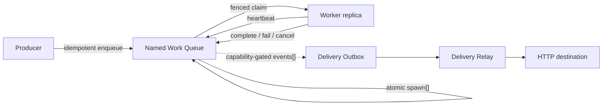

<section class="wh-sec" markdown>
<div class="wh-head" markdown>
<p class="wh-eyebrow">Why Workhold</p>

## Built for work that must not get lost

Reliable background execution without building queue correctness from scratch
or adopting a shared, platform-wide message bus.
</div>

<div class="wh-tiles" markdown>
<div class="wh-tile" markdown>
<p class="wh-tile__n">01</p>

### Keep work through crashes

A successful enqueue is committed to Workhold's PostgreSQL before it is
acknowledged.
</div>
<div class="wh-tile" markdown>
<p class="wh-tile__n">02</p>

### Scale workers safely

Replicas compete for tasks under fenced, renewable leases. Stale workers cannot
mutate queue state.
</div>
<div class="wh-tile" markdown>
<p class="wh-tile__n">03</p>

### Finish work atomically

Completion and `spawn[]` follow-up tasks commit together, so the next step is
not lost.
</div>
</div>
</section>

<section class="wh-sec" markdown>
<div class="wh-head" markdown>
<p class="wh-eyebrow">Capabilities</p>

## What you get

One versioned image is deployed beside each application with independent
`api`, `migrate`, `maintain`, `relay`, and `apply` roles. An application
business database is optional.
</div>

<div class="grid cards" markdown>

-   :material-tray-arrow-down:{ .wh-icon } **Durable intake**

    ---

    - Named queues inside one service instance
    - Idempotent enqueue with request fingerprint validation
    - Priority ordering and one-shot future scheduling
    - Admission control before unsafe work reaches PostgreSQL

-   :material-shield-lock-outline:{ .wh-icon } **Safe execution across replicas**

    ---

    - Atomic claim with a rotating secret token and lease generation
    - Heartbeats for long-running handlers
    - At-least-once recovery when a worker crashes or loses its lease
    - Bounded long polling and cooperative cancellation

-   :material-restore-alert:{ .wh-icon } **Predictable failure handling**

    ---

    - Versioned retry policies per named queue
    - Structured failure codes, delayed retries, and dead-letter state
    - Idempotent terminal commands
    - Attempt history and task lineage for diagnosis

-   :material-call-split:{ .wh-icon } **Atomic continuation**

    ---

    - `complete + spawn[]` in one database transaction
    - Follow-up tasks can target other named queues
    - Delivery Outbox and relay for outbound events, capability-gated in the
      public completion API

-   :material-tune-variant:{ .wh-icon } **Production control**

    ---

    - Explicit queue creation and immutable policy versions
    - Pause and drain modes
    - Task, attempt, queue-depth, and dead-letter inspection
    - Migration, maintenance, retention, readiness, metrics, and audited recovery

-   :material-key-chain-variant:{ .wh-icon } **Separate access planes**

    ---

    - Producer, worker, observer, admin, and break-glass principals
    - Role-split Python clients: each process installs only what it needs
    - OpenAPI 3.1 is the authoritative wire contract

</div>
</section>

<section class="wh-sec" markdown>
<div class="wh-head" markdown>
<p class="wh-eyebrow">Lifecycle</p>

## How it works

A producer enqueues idempotently, a worker replica claims under a fenced lease,
and completion can atomically spawn the next step.
</div>



!!! warning "At-least-once, by design"

    Workers process tasks **at least once**. If a lease is lost, another worker
    may receive the task, so handlers and external effects must be idempotent.
    Workhold does not claim exactly-once execution or distributed transactions
    with an application's database. Read the
    [guarantee matrix](01-concepts/09-guarantees.md) before integrating.

[End-to-end lifecycle](01-concepts/03-how-it-works.md){ .md-button .md-button--primary }
[Product boundary](01-concepts/07-product-boundary.md){ .md-button }
</section>

<section class="wh-sec" markdown>
<div class="wh-head" markdown>
<p class="wh-eyebrow">Run it</p>

## Quick start { #quick-start }

Start the service locally, or install the role-specific Python clients.
</div>

=== "Docker"

    Run the service, migrations, and PostgreSQL locally:

    ```bash
    git clone https://github.com/KoninMikhail/workhold-durable-work-queue.git
    cd workhold-durable-work-queue
    docker compose -f docker-compose.dev.yml up --build
    ```

    The public API is available on `http://localhost:8080`.

=== "Host development"

    Python 3.13 and [uv](https://docs.astral.sh/uv/) are required:

    ```bash
    uv sync --group dev
    uv run workhold --help
    uv run pytest
    ```

=== "Python clients"

    Install only the role used by each process:

    ```bash
    pip install workhold-producer   # enqueue, inspect, cancel, and bridge
    pip install workhold-consumer   # claim, heartbeat, complete, fail, and supervise
    pip install workhold-admin      # observe, administer, and break-glass operations
    ```

    The packages share a coordinated version and depend on
    `workhold-client-core`. Async support ships as the `async` extra.

See the [local setup guide](00-onboarding/02-local-setup.md) for configuration,
migrations, Docker profiles, and client development.
</section>

<section class="wh-sec" markdown>
<div class="wh-head" markdown>
<p class="wh-eyebrow">Fit</p>

## Common use cases
</div>

| Use case | How Workhold helps |
| --- | --- |
| **CPU- or I/O-heavy background jobs** | Distribute work across replicas, renew long leases, and safely retry after crashes |
| **Multi-stage processing** | Complete one task and atomically spawn the next stage into another named queue |
| **Scheduled work** | Make a task claimable at a bounded future `available_at` time without a promotion job |
| **Reliable handoff from a business transaction** | Use an app-local transactional outbox and a deterministic idempotency key to bridge into Workhold |
| **Applications without a database** | Enqueue directly; Workhold already owns the durable store |
| **Controlled operational recovery** | Inspect attempts, diagnose failure codes, replay dead letters, and pause or drain queues |

More in [Product use cases](01-concepts/08-use-cases.md) and [Examples](08-examples/README.md).
</section>

<section class="wh-sec" markdown>
<div class="wh-head" markdown>
<p class="wh-eyebrow">Boundaries</p>

## When to choose something else

Workhold is a Work Queue, not a universal messaging system.
</div>

| If you need… | Use… |
| --- | --- |
| Pub/sub, fan-out, or event-log replay | A message broker or event log |
| DAGs, joins, compensation, or human tasks | A workflow orchestrator |
| Exactly-once external effects | Application-level idempotency, inboxes, or natural uniqueness |
| A shared multi-tenant platform bus | A platform messaging service |

RabbitMQ or Kafka can complement Workhold as a downstream delivery channel.
See [Why Workhold](01-concepts/02-why-queue.md) for the detailed comparison.
</section>

<section class="wh-sec" markdown>
<div class="wh-head" markdown>
<p class="wh-eyebrow">Documentation</p>

## Explore the docs
</div>

<div class="wh-links" markdown>
[**Reading path**<span>Understand the product in about 15 minutes</span>](00-onboarding/01-reading-path.md)
[**Integrate an application**<span>Producers, workers, the outbox bridge, and the client SDK</span>](02-guides/README.md)
[**Architecture and ADRs**<span>State machines, concurrency, storage topology, and decisions</span>](04-architecture/README.md)
[**Run in production**<span>Security, deployment, observability, and runbooks</span>](05-operations/README.md)
[**FAQ**<span>One question, one page</span>](06-faq/README.md)
[**Troubleshooting**<span>One symptom, one page</span>](07-troubleshooting/README.md)
</div>
</section>
